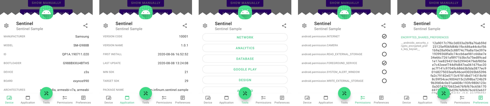

   [](https://www.codefactor.io/repository/github/infinum/android-sentinel/overview/master)

### 

# Sentinel



## Description

_Sentinel_ is a simple one screen UI that provides standardised entry point for tools used in
development and QA alongside device, application and permissions data.  
It's designed to be easily configured and expanded depending on needs and requirements of developers
and QA testers.

The project is organized in the following modules:

- `sentinel` - contains a single screen UI that provides visual information about device,
  application, permissions and tools
- `sentinel-no-op` - contains stubs for easy release implementation of UI package and any Tools
  included
- `tool-chucker` - contains a class wrapper for Chucker
- `tool-collar` - contains a class wrapper for Collar
- `tool-dbinspector` - contains a class wrapper for DbInspector
- `tool-leakcanary` - contains a class wrapper for LeakCanary
- `tool-appgallery` - contains a class wrapper for Huawei AppGallery
- `tool-googleplay` - contains a class wrapper for Google Play
- `tool-timber` - contains a class wrapper for Timber
- `tool-networkemulator-okhttp` - contains a class wrapper for NetworkEmulator
- `tool-showkase` - contains a class wrapper for Showkase
- `tool-showkase-no-op` - contains stubs for easy release implementation of the Showkase wrapper
- `sample` - a sample app for testing and developing


## Table of contents

* [Requirements](#requirements)
* [Usage](#usage)
* [Getting started](#getting-started)
* [Contributing](#contributing)
* [License](#license)
* [Credits](#credits)

## Requirements

This plugin has been written in Kotlin but works both inside Kotlin and Java projects. Minimum
required API level to use _Sentinel_ is *24*.
_Sentinel_ is built with and for AndroidX projects.

## Usage

To include _Sentinel_ in your project, you have to add buildscript dependencies in your project
level `build.gradle` or `build.gradle.kts`:

**Groovy**

```groovy
buildscript {
    repositories {
        mavenCentral()
    }
}
```

**KotlinDSL**

```kotlin
buildscript {
    repositories {
        mavenCentral()
    }
}
```

Then add the following dependencies in your app `build.gradle` or `build.gradle.kts` :

**Groovy**

<!-- 
    If format of version definition is changed, make sure to update `generateReadme` task
-->
```groovy
def sentinelVersion = "2.0.0"
debugImplementation "com.infinum.sentinel:sentinel:$sentinelVersion"
releaseImplementation "com.infinum.sentinel:sentinel-no-op:$sentinelVersion"
```

**KotlinDSL**

```kotlin
val sentinelVersion = "2.0.0"
debugImplementation("com.infinum.sentinel:sentinel:$sentinelVersion")
releaseImplementation("com.infinum.sentinel:sentinel-no-op:$sentinelVersion")
```

<!-- TODO: generateReadme only fills in Sentinel's own version. Extend it to read composeBom and navigation3 from
     gradle/libs.versions.toml, so this note can't fall behind a dependency update. -->
The Deep links tool is built with Jetpack Compose 1.12 and Material 3 1.4 (Compose BOM 2026.09.00) and Navigation 3
1.2, so `sentinel` brings them into your debug build. If your app also uses Compose, Gradle resolves the higher of the
two versions, so your debug build can run a newer Compose than your release build. `sentinel-no-op` doesn't add them.

Basic tools are provided inside the main package but depending on requirements you might want to add
specific tools:

**Groovy**

```groovy
debugImplementation "com.infinum.sentinel:tool-chucker:$sentinelVersion"
debugImplementation "com.infinum.sentinel:tool-collar:$sentinelVersion"
debugImplementation "com.infinum.sentinel:tool-dbinspector:$sentinelVersion"
debugImplementation "com.infinum.sentinel:tool-leakcanary:$sentinelVersion"
debugImplementation "com.infinum.sentinel:tool-appgallery:$sentinelVersion"
debugImplementation "com.infinum.sentinel:tool-googleplay:$sentinelVersion"
debugImplementation "com.infinum.sentinel:tool-timber:$sentinelVersion"
debugImplementation "com.infinum.sentinel:tool-networkemulator-okhttp:$sentinelVersion"
debugImplementation "com.infinum.sentinel:tool-showkase:$sentinelVersion"
releaseImplementation "com.infinum.sentinel:tool-showkase-no-op:$sentinelVersion"
```

**KotlinDSL**

```kotlin
debugImplementation("com.infinum.sentinel:tool-chucker:$sentinelVersion")
debugImplementation("com.infinum.sentinel:tool-collar:$sentinelVersion")
debugImplementation("com.infinum.sentinel:tool-dbinspector:$sentinelVersion")
debugImplementation("com.infinum.sentinel:tool-leakcanary:$sentinelVersion")
debugImplementation("com.infinum.sentinel:tool-appgallery:$sentinelVersion")
debugImplementation("com.infinum.sentinel:tool-googleplay:$sentinelVersion")
debugImplementation("com.infinum.sentinel:tool-timber:$sentinelVersion")
debugImplementation("com.infinum.sentinel:tool-networkemulator-okhttp:$sentinelVersion")
debugImplementation("com.infinum.sentinel:tool-showkase:$sentinelVersion")
releaseImplementation("com.infinum.sentinel:tool-showkase-no-op:$sentinelVersion")
```

Now you can sync your project.

## Getting started

Create or inject an instance of _Sentinel_ in your Application class and start watching for
triggers:

```kotlin
Sentinel.watch(
    setOf(
        ChuckerTool(),
        CollarTool(),
        DbInspectorTool(),
        LeakCanaryTool(),
        AppGalleryTool(appId = "123456789"),
        GooglePlayTool(),
        TimberTool(allowedTags = listOf("EXAMPLE")),
        CertificateTool(userCertificates = listOf()),
        DeepLinkTool()
    )
)
```

A set of tools should be provided as a _watch_ parameter. This set of tools can be empty.

### App Startup

Under the hood Sentinel is using [App Startup library](https://developer.android.com/topic/libraries/app-startup) to initialize itself. 
If you are using [App Startup library](https://developer.android.com/topic/libraries/app-startup) in your project, you might encounter errors related to Sentinel's initialization.

To avoid errors simply add dependency to Sentinel's initializer in your initializer:

```kotlin
class SentinelInitializer : Initializer<Unit> {

    override fun create(context: Context) {
        Sentinel.watch(
            setOf(
                ChuckerTool(),
                DbInspectorTool(),
                GooglePlayTool(),
                TimberTool(),
            ),
        )
    }

    override fun dependencies(): List<Class<out Initializer<*>?>?> = listOf(
        com.infinum.sentinel.SentinelInitializer::class.java,
    )
}
```

### Tools

_Sentinel_ provides several different levels of tools for a developer to implement.

#### Built in

- `AppInfoTool` - opens Android OS Settings page of the application in which _Sentinel_ was
  implemented
- `CrashMonitorTool` - monitors exceptions and ANR crashes of the application in which _Sentinel_
  was implemented
- `BundleMonitorTool` - monitors Bundle objects passed around the application mostly for size
  avoiding _TransactionTooLarge_ exceptions
- `Preference Editor` - by tapping any preference _Sentinel_ opens a screen where you can edit
  current value
- `CertificateTool` - opens a list of system and user provided X.509 certificates with details    
- `DeepLinkTool` - lists the deep links the application declares in its manifest, and lets you build,
  save and launch variants of them with your own query parameters

#### Dependency wrappers

Depending of what you include as module dependencies, very specific tools are provided.

- `ChuckerTool` - a wrapper class that opens [Chucker](https://github.com/ChuckerTeam/chucker)
- `CollarTool` - a wrapper class that opens [Collar](https://github.com/infinum/android-collar)
- `DbInspectorTool` - a wrapper class that
  opens [DbInspector](https://github.com/infinum/android_dbinspector)
- `LeakCanaryTool` - a wrapper class that opens [LeakCanary](https://github.com/square/leakcanary)
- `TimberTool` - a wrapper class that opens [Timber](https://github.com/JakeWharton/timber) . Takes in an optional list of allowed tags for filtering logged messages per tag.
- `AppGalleryTool` - a wrapper class that opens Huawei AppGallery of a published application or a
  web page of the application if Huawei AppGallery is not found
- `GooglePlayTool` - a wrapper class that opens Google Play of a published application or a web page
  of the application if Google Play is not found
- `NetworkEmulatorTool` - a wrapper class that opens [NetworkEmulator](https://github.com/infinum/android-sentinel/tree/master/tool-networkemulator-okhttp). Enables user to modify network conditions.
- `ShowkaseTool` - a wrapper class that opens [Showkase](https://github.com/airbnb/Showkase), Airbnb's
  Compose component browser. Requires additional setup, see [Showkase](#showkase) below.

##### Showkase

Unlike the other wrappers, Showkase needs build configuration in your project, because its
annotation processor has to run over your own sources. The short version:

```groovy
debugImplementation   "com.infinum.sentinel:tool-showkase:$sentinelVersion"
releaseImplementation "com.infinum.sentinel:tool-showkase-no-op:$sentinelVersion"
debugImplementation   "com.airbnb.android:showkase:1.0.5"
kspDebug              "com.airbnb.android:showkase-processor:1.0.5"
```

Use a variant-scoped `ksp` configuration such as `kspDebug`, never the project-wide `ksp`
configuration: that one applies the processor to every variant, production included.

Register the tool with your app's `@ShowkaseRoot` module:

```kotlin
Sentinel.watch(
    setOf(
        ShowkaseTool(MyRootModule::class),
    ),
)
```

[tool-showkase/README.md](tool-showkase/README.md) covers the full setup, flavored projects,
minified builds and troubleshooting.


#### Source abstractions

If you want to implement a different tool other than already packaged with a predefined type and
name, several are available.

- `NetworkTool` - a wrapper interface with a name *Network* for any network interceptors
- `MemoryTool` - a wrapper interface with a name *Memory* for any memory management tools
- `AnalyticsTool` - a wrapper interface with a name *Analytics* for any analytics collectors
- `DatabaseTool` - a wrapper interface with a name *Database* for any database viewers
- `ReportTool` - a wrapper interface with a name *Report* for any crash reporting tools
- `BluetoothTool` - a wrapper interface with a name *Bluetooth* for any Bluetooth loggers
- `DistributionTool` - a wrapper interface with a name *Distribution* for any release distribution
  channels
- `DesignTool` - a wrapper interface with a name *Design* for any design utilities

#### Independent implementations

An interface is provided named _Sentinel.Tool_ that requires implementation of a *String resource*
for a name and a _View.OnClickListener_. An optional icon *Drawable resource* can be supplied.
Implementing this interface enables any class to be provided as a tool in _Sentinel_.

```kotlin
interface Tool {

    @DrawableRes
    fun icon(): Int? = null

    @StringRes
    fun name(): Int

    fun listener(): View.OnClickListener
}
```

### Triggers

_Sentinel_ observes several different trigger events, determining when to show up.
*Manual* trigger cannot be turned off but rest are configurable through _Sentinel_
settings except *Foreground* trigger when running on emulators. Trigger states will be persisted
between sessions.
*Upon first run, all triggers are enabled.*  
Only way to override default trigger behaviour is to explicitly set them in you application manifest.  
If declared, these will override any changes that user does on each application launch.  
Accepted values are *0* and *1* to disable or enable a trigger.  
Anything else will result in the same way like the metadata key isn't declared at all.
```xml
<application
    android:name=".SampleApplication"
    android:icon="@mipmap/ic_launcher"
    android:label="@string/app_name"
    android:roundIcon="@mipmap/ic_launcher_round"
    android:supportsRtl="true"
    android:theme="@style/AppTheme">
  
    ...
  
    <meta-data
        android:name="com.infinum.sentinel.trigger.shake"
        android:value="1" />

    <meta-data
        android:name="com.infinum.sentinel.trigger.proximity"
        android:value="0" />

    <meta-data
        android:name="com.infinum.sentinel.trigger.foreground"
        android:value="0" />

    <meta-data
        android:name="com.infinum.sentinel.trigger.usb_connected"
        android:value="0" />

    <meta-data
        android:name="com.infinum.sentinel.trigger.airplane_mode_on"
        android:value="0" />

    ...
  
</application>
```

- `Manual` - used for manually triggering UI with _show()_
- `Shake` - default trigger to show UI, shake device to invoke
- `Proximity` - shows UI every time sensor detects _near_ state  
- `Foreground` - shows UI every time application goes into foreground
- `USB connected` - shows UI every time an USB cable is plugged in
- `Airplane mode on` - shows UI every time Airplane mode is turned on

### Formatters

Data gathered and presented by _Sentinel_ can be shared to any text compliant recipient
applications.
_Sentinel_ provides a few simple text formatters for easy integrations into other systems.
_Plain_ formatter is selected by default, but selecting any other is persisted between sessions.

- `Plain`
- `Markdown`
- `JSON`
- `XML`
- `HTML`

### Crash monitor

_Sentinel_ has a built in default uncaught exception handler and ANR observer. If switched on in
settings, it will notify both in a form of a notification. Note that from Android 13 you need to give permission 
to the app to show notifications.
Once tapped on this notification, a screen with details is shown. A complete list of crashes is
persisted between sessions and available on demand.    
Methods to react on these crashes in a graceful way are provided in _Sentinel_.

```kotlin
Sentinel.setExceptionHandler { _, exception ->
    println("Exception happened: ${exception.message}")
    exitProcess(exception.hashCode())
}

Sentinel.setAnrListener { exception ->
    println("ANR happened: ${exception.message}")
    exitProcess(exception.hashCode())
}
```

### Bundle monitor

_Sentinel_ monitors Bundle objects passed around the application mostly for size limit of 500kB,
thus avoiding _TransactionTooLarge_ exceptions.  
In settings there are options to notify inside a running session, toggle specific variants or set
the limit of Bundle size.  
This monitor feature runs automatically for every _Activity_ but if you wish to disable monitoring
for a specific screen, you can do so in the _AndroidManifest.xml_ by adding a _meta-data_ node.
```xml
<activity
    android:name="com.example.ui.main.MainActivity"
    android:exported="false">
    <meta-data
      android:name="@string/sentinel_infinum_monitored"
      android:value="false" />
</activity>
```

### Deep links

_Sentinel_ reads the intent filters declared in the application's manifest and lists the deep links they accept (content and file schemes,
MIME-type filters and non-exported screens are left out), grouped by the screen that declares them. Add `DeepLinkTool`
to the watched tools:

```kotlin
DeepLinkTool(
    exampleLinks = listOf(
        DeepLinkTool.ExampleLink("myapp://product/123?ref=push", "Product 123")
    )
)
```

Example links are optional. Use them for links with realistic IDs or parameters that the manifest can't describe.
They are listed in an "Example links" section above the declared links.

For every link you can:

- create variants with your own query parameters, and fill in pattern links such as `/product/*`. Variants are saved
  on the device. Pattern links (templates) can't be launched, copied or shared as they are: you launch, copy and share
  them through a variant that fills them in.
- launch the link the way a tap in another app would ("Real tap"), or, for web links, directly into the application ("Open in this app"). Web links ask which one; other links open with Real tap.
  A link whose screen lacks the `BROWSABLE` category can't take a Real tap, so it opens in the application directly.
  The variant editor's Launch action saves the variant and launches it in one step.
- see warnings for declarations that break real links, such as a missing `DEFAULT` or `BROWSABLE` category, a link
  declared by two screens, or a disabled screen
- open a breakdown of the link's parts, and copy or share it
- on Android 12 and later, see whether a web link's domain is verified, and open the system link settings

When you test with the tool:

- Every launch from the tool is a warm start, because the application is already running. To test a cold start, copy
  the link, force-stop the application with `adb shell am force-stop <applicationId>`, then open the link from another
  app, such as a notes or chat app.
- Only one installed app can own a web link's domain or receive a custom scheme without a chooser. If a second build of
  the application is installed, for example a debug and a release build, links can open in that build instead.
- On Android 17 and later, `adb shell am start --debug-link -a android.intent.action.VIEW -d "<link>"` shows how the
  system resolved a link, including Dynamic App Links rules that the tool can't read.

## Contributing

We believe that the community can help us improve and build better a product.
Please refer to our [contributing guide](CONTRIBUTING.md) to learn about the types of contributions we accept and the process for submitting them.

To ensure that our community remains respectful and professional, we defined a [code of conduct](CODE_OF_CONDUCT.md) that we expect all contributors to follow.

For easier developing a `sample` application with
proper implementations is provided. If you wish to add a new specific dependency wrapper tool,
create a new module and set it up like the ones already provided. Then create a pull request.

We appreciate your interest and look forward to your contributions.

## License

```
Copyright 2020 Infinum

Licensed under the Apache License, Version 2.0 (the "License");
you may not use this file except in compliance with the License.
You may obtain a copy of the License at

   http://www.apache.org/licenses/LICENSE-2.0

Unless required by applicable law or agreed to in writing, software
distributed under the License is distributed on an "AS IS" BASIS,
WITHOUT WARRANTIES OR CONDITIONS OF ANY KIND, either express or implied.
See the License for the specific language governing permissions and
limitations under the License.
```

## Credits
Maintained and sponsored by [Infinum](http://www.infinum.com).

<p align="center">
  <a href='https://infinum.com'>
    <picture>
        <source srcset="https://assets.infinum.com/brand/logo/static/white.svg" media="(prefers-color-scheme: dark)">
        
    </picture>
  </a>
</p>
